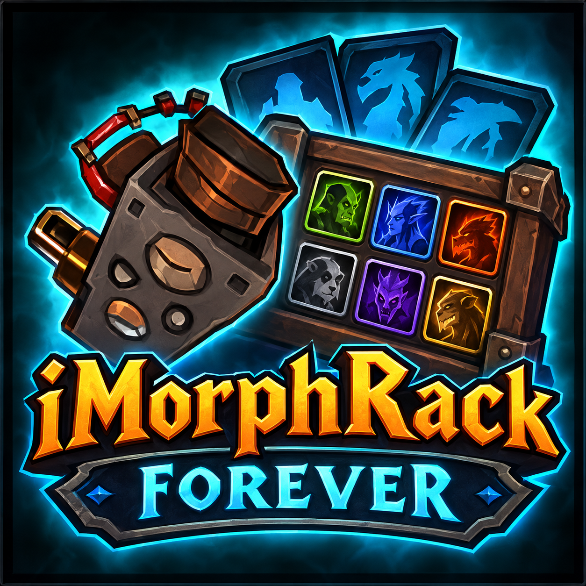

  

<h1 align="center">iMorph Rack (Forever)</h1>

  <strong>A clean interface for iMorph's cosmetic commands.</strong> 
  <em>Une interface claire pour les commandes cosmétiques d'iMorph.</em>

  <a href="#english">English</a> · <a href="#français">Français</a>

## English

iMorph Rack gives iMorph's cosmetic commands a clean, fully custom animated window. Change your race, gender, model, gear and weapon enchants by clicking instead of typing commands, and keep your favourite looks as presets that can come back on their own at login.

iMorph Rack is an interface only: it needs iMorph to be running and injected into the game. Until it is, the window tells you so and the commands are not sent.

### Features

- **Race and gender:** classic races, other races available on your client, or any race by its ID.
- **Appearance:** player model, shapeshift forms (form ID and display ID), pet morph and dismount.
- **Items:** set an item for every equipment slot, fill every slot with your current gear, add weapon enchants, then apply one slot or all of them.
- **Item database:** more than 15,000 items from WoW Forever, including its new gear and cosmetics, searchable by name or ID and filterable by slot, category, quality and level. Click to copy an ID, Ctrl-click to preview, right-click to copy and apply.
- **Presets:** every command you send is tracked per character. Save your current look as a preset in one click, apply, update, rename, export or import it, and reapply your last look or a preset automatically at login.
- **Your own commands:** save named commands, edit them later. Several commands can go on one line, separated by `;`.
- **Cosmetic only:** commands that touch gameplay (speed, flying, teleport, collisions and similar) are refused.
- **Reset:** one button to undo every change.
- **English and French:** follows your game language, or pick one in the title bar.
- **Report a bug:** the Bug button in the title bar gives you the Discord link, ready to copy.
- **Minimap button:** click to open or close the window, drag to move it.

### Installation

Copy the `iMorphRack_Forever` folder into `Interface\AddOns`, then restart the game or reload your interface. Launch iMorph and inject it into the game as usual.

### Commands

| Command | What it does |
|---|---|
| `/imr` or `/imorphrack` | Open or close the window |
| `/imr <preset>` | Apply a preset |
| `/imr reset` | Undo every change |
| `/imr bug` | Get the Discord link to report a bug |

### Copyright

Copyright (c) 2026 Daeler. All rights reserved. iMorph belongs to its own authors and is not included.

---

## Français

iMorph Rack donne aux commandes cosmétiques d'iMorph une fenêtre claire, entièrement personnalisée et animée. Changez de race, de genre, de modèle, d'équipement et d'enchantements d'arme en cliquant au lieu de taper des commandes, et gardez vos apparences préférées en presets, qui peuvent revenir tout seuls à la connexion.

iMorph Rack n'est qu'une interface : iMorph doit être lancé et injecté dans le jeu. Tant que ce n'est pas le cas, la fenêtre vous le signale et les commandes ne sont pas envoyées.

### Fonctionnalités

- **Race et genre :** races classiques, autres races disponibles selon votre client, ou n'importe quelle race par son ID.
- **Apparence :** modèle du personnage, formes (ID de forme et ID d'affichage), morph du familier et descente de monture.
- **Objets :** un objet pour chaque emplacement, remplissage avec votre équipement actuel, enchantements d'arme, puis application d'un emplacement ou de tous.
- **Base de données :** plus de 15 000 objets de WoW Forever, nouveaux équipements et cosmétiques compris, recherche par nom ou ID, filtres par emplacement, catégorie, qualité et niveau. Clic pour copier un ID, Ctrl-clic pour l'aperçu, clic droit pour copier et appliquer.
- **Presets :** chaque commande envoyée est suivie par personnage. Enregistrez votre look actuel en preset d'un clic, appliquez-le, mettez-le à jour, renommez-le, exportez-le ou importez-le, et réappliquez automatiquement votre dernier look ou un preset à la connexion.
- **Vos commandes :** enregistrez des commandes nommées et modifiez-les ensuite. Plusieurs commandes peuvent tenir sur une ligne, séparées par `;`.
- **Cosmétique uniquement :** les commandes qui touchent au gameplay (vitesse, vol, téléportation, collisions, etc.) sont refusées.
- **Réinitialisation :** un bouton pour annuler tous les changements.
- **Français et anglais :** suit la langue de votre jeu, ou choisissez-la dans la barre de titre.
- **Signaler un bug :** le bouton Bug de la barre de titre donne le lien Discord, prêt à copier.
- **Bouton de minicarte :** clic pour ouvrir ou fermer la fenêtre, glisser pour le déplacer.

### Installation

Copiez le dossier `iMorphRack_Forever` dans `Interface\AddOns`, puis relancez le jeu ou rechargez l'interface. Lancez iMorph et injectez-le dans le jeu comme d'habitude.

### Commandes

| Commande | Effet |
|---|---|
| `/imr` ou `/imorphrack` | Ouvrir ou fermer la fenêtre |
| `/imr <preset>` | Appliquer un preset |
| `/imr reset` | Annuler tous les changements |
| `/imr bug` | Obtenir le lien Discord pour signaler un bug |

### Droits d'auteur

Copyright (c) 2026 Daeler. Tous droits réservés. iMorph appartient à ses auteurs et n'est pas inclus.
