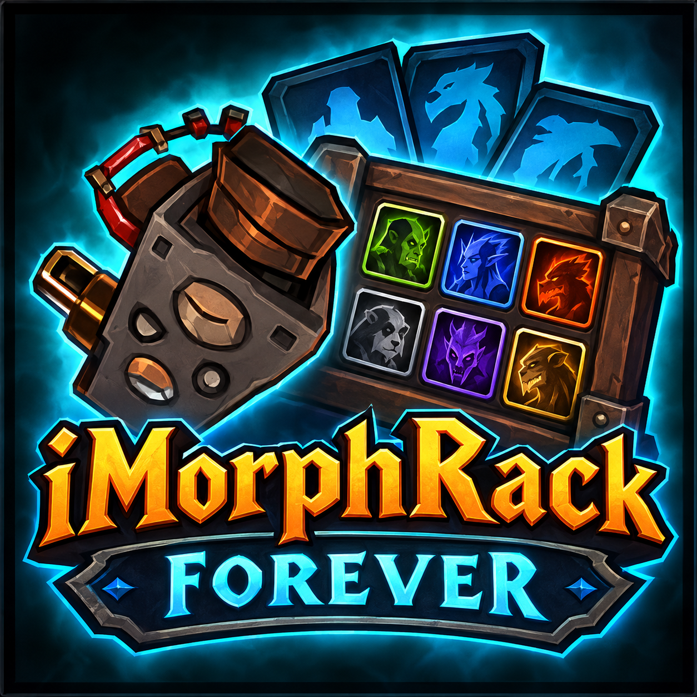

  

<h1 align="center">iMorph Rack (Forever)</h1>

  <strong>A clean interface for iMorph's cosmetic commands.</strong> 
  <em>Une interface claire pour les commandes cosmétiques d'iMorph.</em>

  <a href="#english">English</a> · <a href="#français">Français</a>

## English

iMorph Rack gives iMorph's cosmetic commands a spellbook-style window. Change your race, gender, model, gear and weapon enchants by clicking instead of typing commands, and keep your favourite looks as saved outfits.

iMorph Rack is an interface only: it needs iMorph to be running and injected into the game. Until it is, the window tells you so and the commands are not sent.

### Features

- **Race and gender:** classic races, other races available on your client, or any race by its ID.
- **Appearance:** player model, shapeshift forms (form ID and display ID), pet morph and dismount.
- **Items:** set an item for every equipment slot, fill every slot with your current gear, add weapon enchants, then apply one slot or all of them.
- **Item database:** about 13,500 items, searchable by name or ID and filterable by slot, category, quality and level. Click to copy an ID, Ctrl-click to preview, right-click to copy and apply.
- **Your own commands:** save named commands or whole outfits. Several commands can go on one line, separated by `;`.
- **Cosmetic only:** commands that touch gameplay (speed, flying, teleport, collisions and similar) are refused.
- **Reset:** one button to undo every change.
- **English and French:** follows your game language, or pick one in the window.
- **Minimap button:** click to open or close the window, drag to move it.

### Installation

Copy the `iMorphRack_Forever` folder into `Interface\AddOns`, then restart the game or reload your interface. Launch iMorph and inject it into the game as usual.

### Commands

| Command | What it does |
|---|---|
| `/imr` or `/imorphrack` | Open or close the window |

### Copyright

Copyright (c) 2026 Daeler. All rights reserved. iMorph belongs to its own authors and is not included.

---

## Français

iMorph Rack donne aux commandes cosmétiques d'iMorph une fenêtre façon grimoire. Changez de race, de genre, de modèle, d'équipement et d'enchantements d'arme en cliquant au lieu de taper des commandes, et gardez vos apparences préférées comme tenues enregistrées.

iMorph Rack n'est qu'une interface : iMorph doit être lancé et injecté dans le jeu. Tant que ce n'est pas le cas, la fenêtre vous le signale et les commandes ne sont pas envoyées.

### Fonctionnalités

- **Race et genre :** races classiques, autres races disponibles selon votre client, ou n'importe quelle race par son ID.
- **Apparence :** modèle du personnage, formes (ID de forme et ID d'affichage), morph du familier et descente de monture.
- **Objets :** un objet pour chaque emplacement, remplissage avec votre équipement actuel, enchantements d'arme, puis application d'un emplacement ou de tous.
- **Base de données :** environ 13 500 objets, recherche par nom ou ID, filtres par emplacement, catégorie, qualité et niveau. Clic pour copier un ID, Ctrl-clic pour l'aperçu, clic droit pour copier et appliquer.
- **Vos commandes :** enregistrez des commandes nommées ou des tenues entières. Plusieurs commandes peuvent tenir sur une ligne, séparées par `;`.
- **Cosmétique uniquement :** les commandes qui touchent au gameplay (vitesse, vol, téléportation, collisions, etc.) sont refusées.
- **Réinitialisation :** un bouton pour annuler tous les changements.
- **Français et anglais :** suit la langue de votre jeu, ou choisissez-la dans la fenêtre.
- **Bouton de minicarte :** clic pour ouvrir ou fermer la fenêtre, glisser pour le déplacer.

### Installation

Copiez le dossier `iMorphRack_Forever` dans `Interface\AddOns`, puis relancez le jeu ou rechargez l'interface. Lancez iMorph et injectez-le dans le jeu comme d'habitude.

### Commandes

| Commande | Effet |
|---|---|
| `/imr` ou `/imorphrack` | Ouvrir ou fermer la fenêtre |

### Droits d'auteur

Copyright (c) 2026 Daeler. Tous droits réservés. iMorph appartient à ses auteurs et n'est pas inclus.
